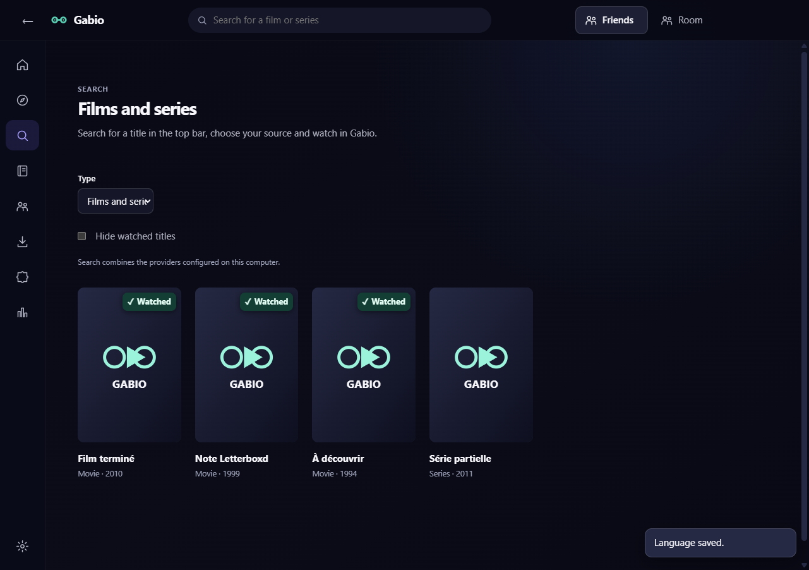
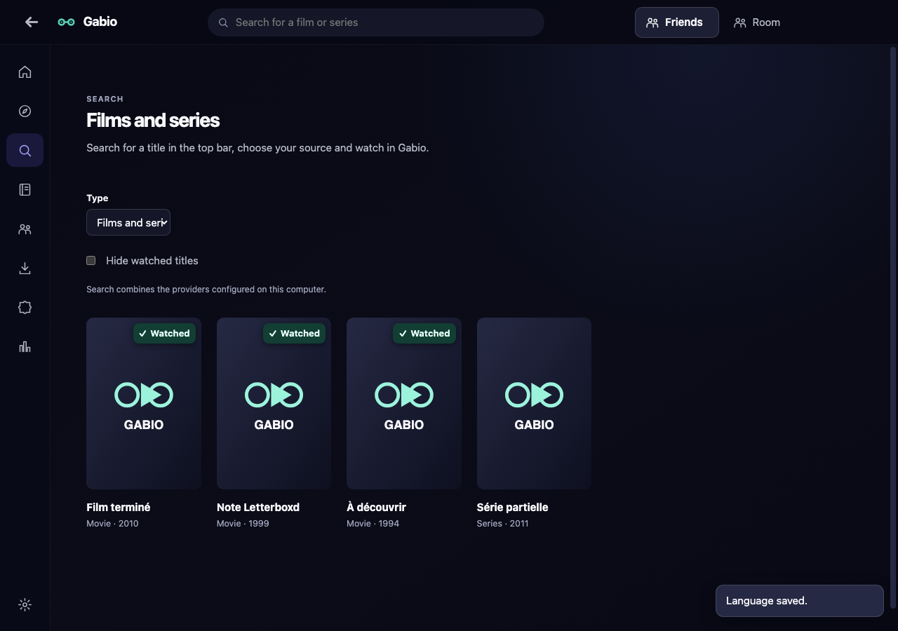

# Gabio — downloads and installation

[Guide d’installation en français](README.md)

Gabio is available for Windows, Android, iPhone, iPad and Mac. Apple and Android
builds are prereleases. Application source code remains private.

## Contents

- [Latest iPhone/iPad IPA and all downloads](#latest-iphone--ipad-version)
- [Choose French or English](#choose-french-or-english)
- [See and hide watched titles](#see-and-hide-watched-titles)
- [Prompt invitations and film credits](#prompt-invitations-and-film-credits)
- [Choose episode downloads](#download-episodes-with-your-chosen-versions)
- [Install and update on Windows](#install-on-windows)
- [Install and update on Android](#install-on-android)
- [First Android launch: name, addons and sync](#first-launch-on-android)
- [Install and update on iPhone/iPad with AltStore](#install-on-iphone-or-ipad)
- [Install and update on Mac](#install-on-mac)
- [Security alerts and troubleshooting](#security-alerts-and-troubleshooting)
- [Apple beta checks and limitations](#apple-beta-checks-and-limitations)

## Latest iPhone / iPad version

**Gabio 1.1.0 — build 9**:
[download the latest universal IPA, Gabio-iOS-1.1.0-unsigned.ipa](https://github.com/GabGaabS/gabio-release/releases/download/apple-v1.1.0/Gabio-iOS-1.1.0-unsigned.ipa).
The same IPA supports both iPhone and iPad, starting with iOS/iPadOS 17.0.

[Add Gabio to AltStore Classic](https://altstore.io/source/raw.githubusercontent.com/GabGaabS/gabio-release/main/altstore/gabio.json?app=io.gabio.apple) ·
[Apple beta release notes](https://github.com/GabGaabS/gabio-release/releases/tag/apple-v1.1.0) ·
[SHA-256 checksums](https://github.com/GabGaabS/gabio-release/releases/download/apple-v1.1.0/SHA256SUMS-Apple.txt)

| Platform | Download | Installation |
| --- | --- | --- |
| Windows | **4.4.1**: [64-bit Windows EXE](https://github.com/GabGaabS/gabio-release/releases/download/v4.4.1/Gabio-Setup-4.4.1.exe) · [Latest stable release](https://github.com/GabGaabS/gabio-release/releases/latest) | Run the installer. Install updates over your existing app. The installer is currently unsigned. |
| Android | **2.4.0 (code 35)**: [ARM64 APK](https://github.com/GabGaabS/gabio-release/releases/download/android-v2.4.0/Gabio-Android-2.4.0-arm64-v8a.apk) · [Universal APK](https://github.com/GabGaabS/gabio-release/releases/download/android-v2.4.0/Gabio-Android-2.4.0-universal.apk) | Allow installation from your chosen browser, then install over Gabio. The existing signing certificate is retained. |
| iPhone / iPad | [IPA 1.1.0, build 9](https://github.com/GabGaabS/gabio-release/releases/download/apple-v1.1.0/Gabio-iOS-1.1.0-unsigned.ipa) | [AltStore guide](#install-on-iphone-or-ipad); personal signing is required. |
| Apple Silicon Mac | [1.4.0 ARM64 ZIP](https://github.com/GabGaabS/gabio-release/releases/download/macos-v1.4.0/Gabio-macOS-1.4.0-arm64.zip) | [Mac guide](#install-on-mac), macOS 13 or later. |
| Intel Mac | [1.4.0 Intel/x64 ZIP](https://github.com/GabGaabS/gabio-release/releases/download/macos-v1.4.0/Gabio-macOS-1.4.0-x64.zip) | [Mac guide](#install-on-mac), macOS 13 or later. |

## Choose French or English

**Windows 4.4.1** supports both languages. Open **Paramètres → Langue de
l’interface → Français / English** and select English. Once changed, the path
is **Settings → Interface language**.

The choice is saved on this device. Your library, history, addons and saved
files are retained. Audio and subtitle languages have separate settings;
catalogue titles, descriptions and track names keep the text provided by
their source.

**Android 2.4.0** also supports both languages. Open **Profil → Langue de
Gabio → Français / English** and select English. The English path is **Profile
→ Gabio language**. The choice is retained after closing and updating the app.

**Mac 1.4.0** supports French / English. Open **Settings → Interface
language** (**Paramètres → Langue de l’interface** with French selected).
The choice is retained after closing and updating. Changing it during playback
preserves the video, position, tracks, volume and calibration.

**iPhone/iPad 1.1.0/build9** offers French / English through **Profile → App language**. Catalog titles, audio and subtitle languages remain separate.

<details>
<summary>Gabio Windows 4.0 screenshot: choosing English</summary>

Actual Electron interface from the published build, using a test profile
without personal data. English is saved and retained after restarting.


</details>

<details>
<summary>Gabio Android 2.0 screenshot: the English profile</summary>

Actual published APK on an isolated emulator with text at 200%. The
default profile shows no personal account or history.


</details>

## See and hide watched titles

Available in **Windows 4.4.1** and **Android 2.4.0 (code 35)**.
A **✓ Watched** check appears on a film’s poster when it is completed in
Gabio, present in your diary, or identified by a personal Letterboxd rating
you explicitly imported or synced. A rating saved only in Gabio is insufficient.
A series needs to be explicitly marked completed as a whole: a completed
episode does not make the entire series watched.

- **Windows**: in search, discovery or an addon catalogue, select
  **Hide watched titles**. This preference is saved on this device.
- **Android**: open search or a catalogue, then select **Hide watched titles**.
  This preference is saved on this device.
- Your library and **Continue watching** remain accessible. If every title
  on a page is hidden, open the next page or disable the filter. Ambiguous
  matches stay visible.

On Windows, your existing Letterboxd integration provides these ratings; you
can also use **Settings → Letterboxd account → Manual import and export →
Import ratings.csv…**. On Android, open **My list → Statistics and diary →
Import my Letterboxd ratings**, then choose **ratings.csv** from your extracted
Letterboxd export, encoded as UTF-8 (up to 2 MB and 10,000 rows).

**Standalone Letterboxd ratings imported on Android stay on that device.**
Import the CSV on each device where you need them: these ratings are not
added to Sync, your diary or your statistics. Library, progress and diary
records keep using their existing sync settings. No watch date is invented.

<details>
<summary>Windows 4.2: Watched checks in English</summary>

Actual Electron interface from the built and inspected 4.2.0 candidate, using
synthetic titles and an isolated test profile with no personal data. The
partially watched series stays visible. This screenshot is not a live catalogue.



</details>

## Prompt invitations and film credits

**Windows 4.4.1, Android 2.4.0 and Mac 1.4.0** receive friend invitations and
requests over a dedicated connection, with automatic fallback. Keep Gabio open
and connected. Notifications stay quiet and do not take focus; they are deferred
while the player is full screen on PC and Mac. A suspended or closed mobile app
cannot guarantee an immediate alert: reopening Gabio refreshes invitations.

Film pages display the **director** and up to **eight main cast members** when
Cinemeta or your addon provides them. Provider names remain unchanged, and no
additional request is made to obtain these credits. Previously cached details
refresh once when next opened online; existing details and artwork remain
available offline.
The public iPhone/iPad IPA remains **1.1.0/build9**.

Checksums for the new installer and APKs:

| File | SHA-256 |
| --- | --- |
| `Gabio-Setup-4.4.1.exe` | `011c9840ef3c1213bd957162eed0d4494da7da4e3803f1c6775e3aa02b1588e2` |
| `Gabio-Android-2.4.0-arm64-v8a.apk` | `f733c187981a08e0d9a55d8a34da92372d082231cb7f0406184e7120715d9963` |
| `Gabio-Android-2.4.0-universal.apk` | `2112d93021ae006dcb8f0b9a125d1843aa2b63f23ff9d3aa8b2e752913d807ef` |

## Download episodes with your chosen versions

**Windows 4.4.1, Android 2.4.0 and Mac 1.4.0** let you prepare a batch before
any transfer. Each episode keeps its own source; the first episode’s source is
not reused for the others.

1. **Windows / Mac**: open a series page, choose a season and select
   **Download episodes**. **Android**: open the series and season, then
   **Keep this season offline** and **Search sources**.
2. Select episodes, then the provider, quality and announced size you want.
   The initial mobile preference targets announced quality up to 1080p without
   announced HDR. 4K and HDR remain explicit choices. Sort sizes or optionally
   set an announced-size limit.
3. Review each episode’s version, provider, announced quality and size, or
   **unknown size**. **Change source** selects an actual version for that episode
   without changing the others. A manual choice outside the preference remains
   your choice; a missing source is never silently replaced by 4K/HDR.
4. Choose or exclude any episode without a matching source. If several episodes
   refer to the same recognized file, change a source or exclude an episode
   before confirming. Different files in the same torrent remain possible when
   their exact file indices are provided.
5. Confirm, then follow transfers in **Downloads**. No item is added before the
   final confirmation. Cancellation or a partial result keeps episodes already
   added; retry the missing ones. Confirmed downloads retain their source and
   resume data.

**Limits: 50 episodes and 200 candidates per episode.** Addon searches remain
bounded; changing the preference and searching again may find another version.
A torrent must identify its exact video file; the batch never guesses an
episode from the largest file.

Quality, HDR and size are **provider declarations**. Only known sizes are added
to the total; unknown sizes are counted separately. Unknown does not mean zero
and cannot guarantee a size limit. The engine still checks the required space.
Adaptive streams or sources requiring custom headers may remain unavailable
for downloading.

**iPhone/iPad: this new preparation belongs to candidate 1.4.0/build12, which is
not public and still awaits a manual test.** In that candidate, use **series
page → season → Prepare this season offline**, then set preferences and review
sources. The public IPA and AltStore remain **1.1.0/build9**; the new controls
are not promised in that IPA. Previously saved files remain in **My list → Downloads**.

## Install on Windows

### First installation

1. On your Windows PC, open the [latest stable release](https://github.com/GabGaabS/gabio-release/releases/latest).
2. Under **Assets**, download **Gabio-Setup-…exe**. The `.blockmap` and `latest.yml` files belong to the updater; they are not installers.
3. Open the EXE, follow the installer and launch Gabio.

**The Windows installer is currently unsigned**: Gabio does not have a Windows
code-signing certificate. Your browser or Windows may show an unrecognized app,
unknown publisher or “Windows protected your PC” warning. These are possible
signature/reputation warnings, not a guarantee that a file is safe.
[Microsoft explanation](https://learn.microsoft.com/en-us/windows/apps/package-and-deploy/smartscreen-reputation).

After checking that the file comes from **GabGaabS/gabio-release** and matches
the checksum in its release notes, **More info → Run anyway** allows that
installation if SmartScreen offers it. This option may be unavailable on a
managed PC or under Smart App Control. Do not assume a malware detection is
just a signing warning; keep the exact message for troubleshooting.

### Update on Windows

Gabio checks its update channel at startup and announces new versions. In the
update window, select **Download**, then **Install and restart**. You can also
open **Settings → Updates → Check for an update**, then **Restart and install**.
With the French interface, the same controls are **Télécharger**, **Installer
et relancer**, and **Paramètres → Mises à jour → Rechercher une mise à jour →
Redémarrer et installer**.

If the built-in updater fails, download the new EXE using the same stable-release
link and install over Gabio. **Do not uninstall Gabio** for a normal update:
your library, history, settings and saved downloads should be kept. The new
installer may show the same signing warnings.

<details>
<summary>Gabio screenshot: Windows updates</summary>

French interface, captured using a test profile without personal data.


</details>

## Install on Android

### First installation

Android **8 or later** is required. Open the
[Android 2.4.0 (code 35) prerelease](https://github.com/GabGaabS/gabio-release/releases/tag/android-v2.4.0) on your phone/tablet.
Direct downloads: [ARM64 APK](https://github.com/GabGaabS/gabio-release/releases/download/android-v2.4.0/Gabio-Android-2.4.0-arm64-v8a.apk) · [Universal APK](https://github.com/GabGaabS/gabio-release/releases/download/android-v2.4.0/Gabio-Android-2.4.0-universal.apk).

1. Download the **ARM64 APK** for most recent phones. If it is incompatible or you are unsure, use the larger **universal APK**. The x86/x64 builds mainly serve emulators.
2. Open the APK from your browser’s downloads or a file manager.
3. If Android asks, open **Settings → Allow from this source** for that browser/file manager, return to the APK and select **Install**. Labels vary between manufacturers. You can revoke this source permission afterwards.
4. Open Gabio from your home screen.

Android may warn about installing an unknown app or offer a Play Protect scan
because the APK comes from outside Google Play. **Gabio’s APK is signed**, using
the historical certificate retained for existing installations. It is not
distributed or validated by Google Play. An Android warning should therefore
not be described as the total absence of a signing certificate.
[Install from another source](https://support.google.com/pixelphone/answer/7391672?hl=en),
[Play Protect warning guidance](https://developers.google.com/android/play-protect/warning-dev-guidance).

If protection blocks installation, keep the exact message and APK filename.
Do not globally disable Play Protect or device security to bypass an unknown
diagnosis.

### First launch on Android

With **Android 2.4.0 (code 35)**, a new installation offers the same initial
steps as PC, once:

1. Choose the **name** shown when you watch with friends, then select **Continue**.
2. Choose addons from **ThePirateBay+**, **OpenSubtitles v2** and **Torrentio**
   with CAM releases excluded. Select **Install selected addons** to confirm
   their addition, or **Continue to my devices** to skip this step. Existing
   addon configurations are kept, including disabled addons.
3. **Sync is optional**. To share your name, library and playback progress,
   select **Sync with my devices**. On your already-configured PC, open
   **Profile and sync → Show code**, then enter that private code only in
   the phone’s Gabio form. Your library is merged; videos stay on each device.
   You can also finish with **Explore Gabio** without pairing.

If the PC has no chain yet, select **Create a private chain** and wait for
sync confirmation before sharing its code. On the phone, a **pending** pairing
means the exchange is not confirmed yet: use **Sync now** and keep the displayed
message if the chain is still missing. Never share this code in a public room.

**Set up later** closes the assistant. It will not appear automatically again,
including after interruption, closing or an update. Updating an installation
you have already used keeps its data and does not open the assistant.
To open it yourself later, use **Profile → Review initial setup**.

<details>
<summary>Android 2.0.2 screenshot: optional device sync</summary>

Actual release APK on an isolated emulator with text at 200%. No personal
name, pairing code or user library is displayed.


</details>

### Update on Android

In Gabio 2.0 with English selected, open **Profile → Updates**, then **View
update** when offered. With the French interface, use **Profil → Mises à jour →
Voir la mise à jour**. Download and open the new APK, then confirm
**Update / Install** over the existing app. Android still requires installation
confirmation; Gabio does not silently install APKs.

<details>
<summary>Gabio screenshot: updates in the Android profile</summary>

French interface on an emulator, using a test profile without personal data.


</details>

Keep the same official channel and do not uninstall Gabio. Its historical
certificate lets normal updates retain your data. For a signature conflict or
“App not installed”, check the APK’s origin and architecture, then report the
message before deleting any data.

## Install on iPhone or iPad

### Receive app updates through AltStore

After setting up AltStore Classic with the steps below, open this README in
Safari on your iPhone/iPad and tap **[Add Gabio to AltStore Classic](https://altstore.io/source/raw.githubusercontent.com/GabGaabS/gabio-release/main/altstore/gabio.json?app=io.gabio.apple)**.
Confirm the source and open Gabio’s listing in **Browse**.

If the link does not open, find **Sources → +** in AltStore (through **Browse**
or the Sources tab, depending on your version), then paste this full address:

```text
https://raw.githubusercontent.com/GabGaabS/gabio-release/main/altstore/gabio.json
```

AltStore can download Gabio and offer new versions under **My Apps → Update**.
AltServer must be reachable to sign and install an update. **Refresh All renews
the signature**; it is different from downloading a new app version. New
versions are detected automatically; silent installation without a computer is
not promised. [Official update behaviour](https://faq.altstore.io/developers/updating-apps).

If Gabio was installed from an IPA, keep the same Apple account and install
over it. Do not uninstall the app to add the source. Adding this source still
needs a device check; manual IPA import remains available.

### 1. Prepare your computer and device

Use **AltStore Classic** with **AltServer**. A free personal Apple account is
enough; no paid Apple developer membership is required for this installation.
The downloaded unsigned IPA must be signed by AltStore before it can launch.

On Windows, install [AltServer](https://altstore.io/), iTunes and iCloud following
the [official Windows setup guide](https://faq.altstore.io/altstore-classic/how-to-install-altstore-windows).
It recommends Apple’s iTunes/iCloud builds and explains a separate option for
Microsoft Store iCloud. Check existing tools before replacing them.

On a Mac used to install the iPhone/iPad app, follow the [official Mac AltServer
guide](https://faq.altstore.io/altstore-classic/how-to-install-altstore-macos).
This is separate from installing Gabio’s desktop Mac app, which does not use AltStore.

Start AltServer, connect your unlocked device by USB and accept **Trust this
computer** on the device. To refresh without a cable later, enable Wi-Fi syncing
for that device in iTunes/Finder.

<details>
<summary>Official screenshot: Wi-Fi syncing in iTunes</summary>


</details>

### 2. Install AltStore Classic

From AltServer’s tray/menu-bar icon, choose **Install AltStore → your device**.
Enter your Apple account directly in AltServer.

On the iPhone/iPad, trust the personal profile under **Settings → General →
VPN & Device Management**. Enable **Settings → Privacy & Security → Developer
Mode**, then confirm the required restart. Labels vary with iOS/iPadOS.
[Official procedure](https://faq.altstore.io/altstore-classic/how-to-install-altstore-windows).

<details>
<summary>Official screenshot: where to find Developer Mode</summary>


Credit: 9to5Mac, via AltStore’s documentation.

</details>

### 3. Install Gabio manually if needed

In Safari on your device, download [**Gabio-iOS-1.1.0-unsigned.ipa**](https://github.com/GabGaabS/gabio-release/releases/download/apple-v1.1.0/Gabio-iOS-1.1.0-unsigned.ipa) and keep it in
Files. In **AltStore Classic → My Apps → +**, select that IPA. AltServer must
remain reachable over USB or the same Wi-Fi network. Launch Gabio after signing
and installation. The Mac ZIP files cannot be installed on an iPhone/iPad.

If you downloaded the IPA on Windows, hold **Shift** while clicking AltServer’s
tray icon and choose **Sideload .ipa…**, then your device and the Gabio IPA.
Enter your account directly in AltServer if asked.
[AltServer release notes](https://faq.altstore.io/release-notes/altserver).

<details>
<summary>Official screenshot: + and Refresh All in My Apps</summary>


Image from the [AltStore documentation](https://faq.altstore.io/altstore-classic/your-altstore).
The pictured apps are official examples; Gabio will appear in your list.

</details>

### 4. Renew the signature and update Gabio

With a free account, apps expire after **seven days** and AltStore occupies one
of the **three active-app slots**. Keep AltServer running and use **My Apps →
Refresh All** before expiry. Automatic renewal depends on the computer and
network being available. [Limits and renewal](https://faq.altstore.io/altstore-classic/your-altstore).

For a new Gabio version, use **Update** from the source or import the new IPA
with **the same Apple account** over the existing app. Do not uninstall Gabio to
renew its signature. If AltStore expires, AltServer can reinstall it over the
existing installation. [AltServer explanation](https://faq.altstore.io/altstore-classic/altserver).

For **Could not find AltServer**, check the computer is awake, AltServer is
running and USB/Wi-Fi is connected. [Troubleshooting](https://faq.altstore.io/altstore-classic/troubleshooting-guide).

These official screenshots show older interfaces and are reference points.
Installing and updating Gabio through AltStore has been confirmed on the test
iPad; the iPhone procedure still needs a physical check. Never send your Apple
credentials through GitHub, Gabio or chat.

### Background transfers

On iOS/iPadOS 26+, Gabio can request continued active transfers with visible
progress and cancellation that preserves downloaded files. This option remains
under validation; iOS may refuse or interrupt it. Keep Gabio open if unavailable.

AltStore can change the app’s identifier during signing. Background-task
identifiers may need a local IPA preparation matching **the already-installed
Gabio app**. That preparation changes only the task manifest, not application
code. A prepared build3 update was checked and installed successfully; long
transfers remain untested. This preparation is optional for playback and
downloads while keeping the app open. Keep the existing installation and account.

## Install on Mac

**Gabio Mac 1.4.0 — prerelease**: [release notes](https://github.com/GabGaabS/gabio-release/releases/tag/macos-v1.4.0) ·
[SHA-256 checksums for both ZIP files](https://github.com/GabGaabS/gabio-release/releases/download/macos-v1.4.0/SHA256SUMS-macOS.txt).
Separate Mac release: these 1.4.0 ZIP files bundle PC base 4.4.1. The public iPhone/iPad IPA remains 1.1.0/build9; iOS 1.4.0/build12 awaits a new manual iPad test when its user is available.

Check the ZIP filename and SHA-256 checksum before opening it:

| File | SHA-256 |
| --- | --- |
| `Gabio-macOS-1.4.0-arm64.zip` | `a66952d7869ab9c9a80f38266f1d087eb34007453bc698a5c7e3bb86bc079d0d` |
| `Gabio-macOS-1.4.0-x64.zip` | `45f1f2c4af5389909840f4a98d85555655ef19ab78ba94512ab3b92502b6c07d` |


### 1. Choose your download

Open **Apple menu  → About This Mac**:

- **Apple chip M1, M2, M3, M4…**: [Gabio 1.4.0 Apple Silicon / ARM64](https://github.com/GabGaabS/gabio-release/releases/download/macos-v1.4.0/Gabio-macOS-1.4.0-arm64.zip).
- **Intel processor**: [Gabio 1.4.0 Intel / x64](https://github.com/GabGaabS/gabio-release/releases/download/macos-v1.4.0/Gabio-macOS-1.4.0-x64.zip).

macOS **13 or later** is required. Mac ZIP files contain the desktop application;
the IPA belongs to iPhone/iPad. Installing the Mac desktop app does not require
AltStore or an Apple account.

### 2. Install and open Gabio

1. Download the ZIP for your architecture.
2. Double-click the ZIP in **Finder → Downloads** to extract it.
3. Move **Gabio.app** to **Applications**, then open it there.
4. Confirm the first-launch prompt if macOS asks.

Gabio currently uses an **ad hoc signature**, without an Apple Developer ID or
notarization. If macOS blocks it as an unidentified developer, after attempting
to open it, go to **System Settings → Privacy & Security → Open Anyway**, then
confirm **Open**. This exception applies to that app.
[Official Apple procedure](https://support.apple.com/en-us/102445).

<details>
<summary>Official Apple screenshot: allow first launch</summary>


The reference screenshot uses French; **Ouvrir quand même** means **Open Anyway**.

</details>

For a damaged archive/app message, download the ZIP again and compare it with
[SHA256SUMS-macOS.txt](https://github.com/GabGaabS/gabio-release/releases/download/macos-v1.4.0/SHA256SUMS-macOS.txt). Keep the exact message if it persists; do
not disable macOS security globally.

### 3. Update on Mac

Mac updates are **manual** in this beta. Return to this README, download the new
ZIP for your architecture, quit Gabio, extract it and replace only **Gabio.app**
in Applications. Keep your Gabio data and saved files; deleting them is not
necessary.

The shared Apple channel and AltStore source remain on 1.1.0/build9. The built-in Mac updater reads that shared channel and does not offer Mac 1.4.0 yet. Use this guide’s direct ZIP links; installation remains manual.

### 4. Start using Gabio

Open **Addons** directly in the sidebar to configure your sources, then choose
a title/version in **Découvrir** (Discover) or **Recherche** (Search). Rooms and
the remote require Internet; each
device plays its own video. Saved files can be played offline. Grant local
network permission when using a local-network feature offered by Gabio.

### 5. Use installed addons on Mac

In **Addons**, open the provider’s configuration when required, then confirm
adding its configured manifest. In **Discover → Your addon catalogs**,
choose its catalog, complete the required fields and click **Show catalog**.
**Show more** loads the next page when the provider offers several pages.

Mac 1.4.0 handles compatible movie, series and anime catalogs, their filters and
searches, metadata and episodes using the addon’s own identifiers, and the
streams and subtitles it supplies. Tracks embedded in the file remain available
in the player. When an addon returns an external playback website, Gabio offers
to open that website.

Titles with an addon-specific identity remain available for solo playback;
their local progress is not shared through Sync. Some HLS/DASH sources requiring
headers on their segments are explicitly refused: choose another source instead.

Legacy JSON-RPC transports cannot be installed. An unavailable or misconfigured
addon, or one returning an unsupported format, can still fail: adding it does
not guarantee every feature of its service. Provider errors remain visible;
not every addon in the shop has been validated with real playback. DRM services,
specific video platforms and special formats do not become supported merely by
adding an addon.

### 6. Watched posters and the local filter on Mac

Mac 1.4.0 marks watched films and series with a checkmark and **Watched**. **Hide watched titles** starts disabled and is remembered on this device. It filters discovery, search and catalogues; the library remains accessible and a fully hidden page retains its pagination.

Movies can use completed library status, completed playback, the journal or an explicitly imported Letterboxd rating. One episode never marks an entire series. A standalone rating invents no date, watch or statistics. Remakes and ambiguous identities stay separate.

English Mac 1.2.0 screenshot from the Intel runner, using a synthetic profile and the actual renderer components; no user data:



<details>
<summary>Gabio screenshot: settings on Mac</summary>

Gabio 0.1.0, French interface on the Mac used to build and test the app.


</details>

## Security alerts and troubleshooting

| Platform | Possible alert and reason | What to check |
| --- | --- | --- |
| Windows | Unknown publisher / SmartScreen reputation: no Windows signing certificate. | Official origin and checksum; allow this file only if that option is offered. |
| Android | Unknown source / Play Protect scan: installed outside Google Play, with the historical certificate still present. | APK architecture, version and origin; permission for your chosen browser. |
| iPhone/iPad | Untrusted personal profile, Developer Mode disabled, missing AltServer or expired signature. | Profile, Developer Mode, AltServer connection and **Refresh All** within seven days. |
| Mac | Unidentified developer: ad hoc signature, no Developer ID/notarization. | Correct ZIP architecture and checksum, then the local **Open Anyway** exception. |

For persistent issues, use **Signaler un problème** (Report a problem) in Gabio
or open an **Issue** in this repository. Include your operating system, app
version, filename and exact message. Review diagnostics before sharing them;
do not include Apple credentials, Sync codes or private addon URLs. An explicit
malware or modified-file detection needs a separate examination from a simple
reputation warning.

## Apple beta checks and limitations

The guides, Windows 4.4.1, Android 2.4.0 and Mac 1.4.0 retain French / English support. iOS 1.1.0/build9 received limited manual acceptance on the test iPad on 2026-10-17: update with data preserved, Cinemeta New / Show titles, and the player actions actually listed in the release notes. Full automated iPhone/iPad suites are not qualified for this build. No additional physical iPhone acceptance is implied.

For iOS 0.1.0/build3, the test iPad passed update, design, film/episode playback
and resume, integrated subtitles, controls hiding, library management, rooms,
remote and Sync checks. Its fifteen scenarios pass on each simulator family.
These historical results do not qualify iOS 1.1.0/build9.

Mac 1.4.0 was checked on native Apple Silicon and Intel runners ([arm64](https://github.com/GabGaabS/gabio-release/actions/runs/39087275022) · [x64](https://github.com/GabGaabS/gabio-release/actions/runs/39087303800)). The AppKit/libVLC player and new episode-download dialog were exercised using synthetic profiles and videos. Application files in both ZIPs were compared with the pinned source. No new customer Mac or macOS 13 is qualified; Gatekeeper, TV, HDR/multichannel audio and long-transfer limitations still apply.

**Historical Mac 1.3 qualification:**

Mac 1.3.0 passes native checks on one Apple Silicon host and one Intel host:
the actual AppKit/libVLC player, playback, menus, offline playback, full screen,
minimize/restore, PiP and returning from another app. Playback restoration after
closing and reloading confirms the requested position before pausing, then checks
that the paused position remains stable. Film credits, including a previously
cached page, and the invitation channel over real local WebSockets are also
checked. Tests use synthetic profiles and videos. No new customer Mac or macOS 13
is qualified; Gatekeeper when opening the downloaded ZIP, TVs, HDR/multichannel
audio and long transfers retain their hardware-validation limits.

Limits are described in the [Mac 1.4.0 notes](https://github.com/GabGaabS/gabio-release/releases/tag/macos-v1.4.0) and
[iOS 1.1.0/build9 notes](https://github.com/GabGaabS/gabio-release/releases/tag/apple-v1.1.0). Native-library licences
accompany the apps.

Download from this public repository and check the
[Mac 1.4.0 SHA-256 checksums](https://github.com/GabGaabS/gabio-release/releases/download/macos-v1.4.0/SHA256SUMS-macOS.txt) or the
[iOS 1.1.0 SHA-256 checksums](https://github.com/GabGaabS/gabio-release/releases/download/apple-v1.1.0/SHA256SUMS-Apple.txt).
Windows and Android retain their separate channels and Windows remains the global Latest release. The Apple channel and AltStore source describe only this verified Apple prerelease. This public repository contains binaries, guides and download metadata, not application sources, user data or diagnostic logs.