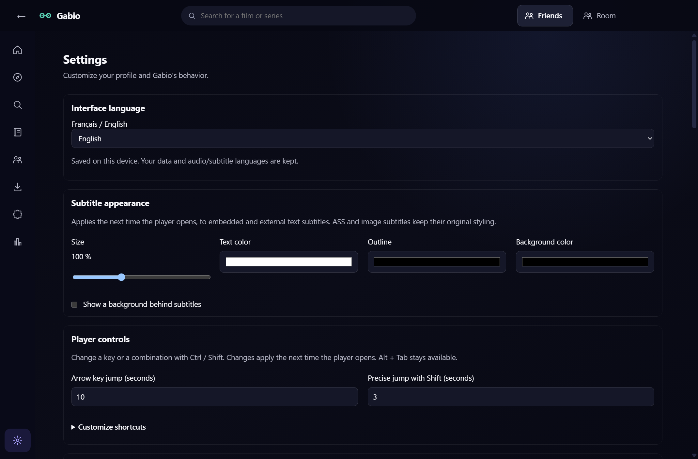
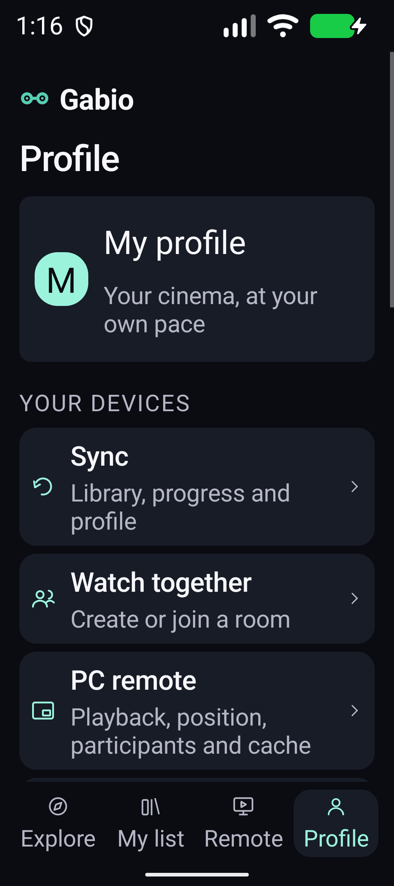
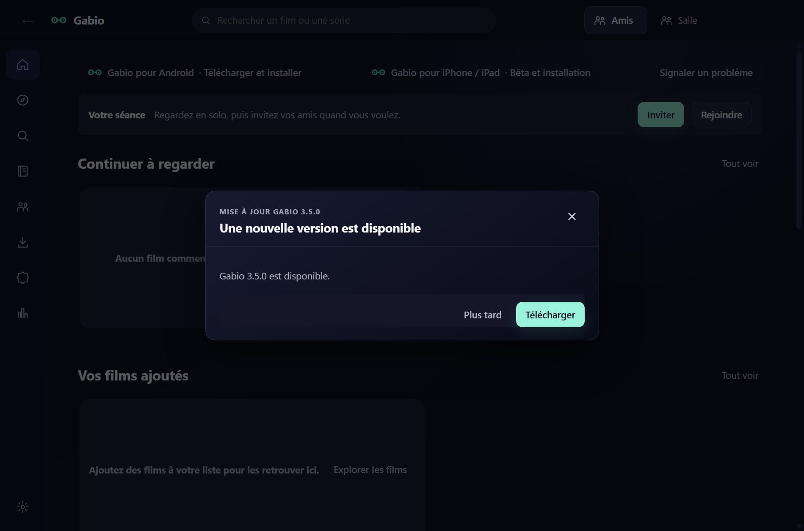
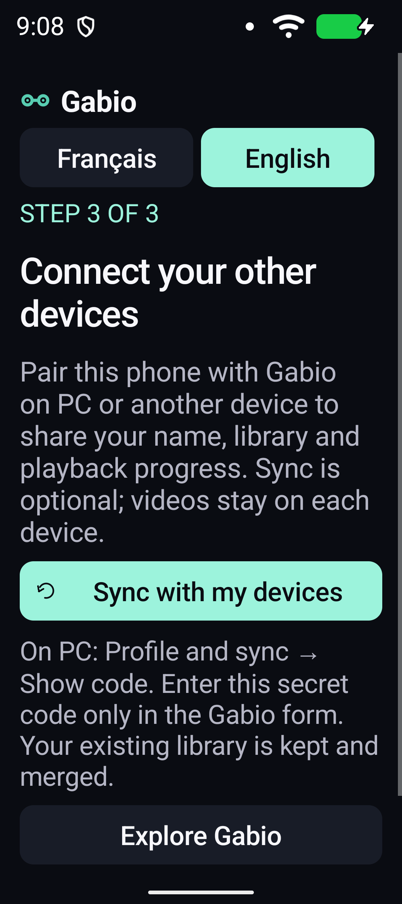
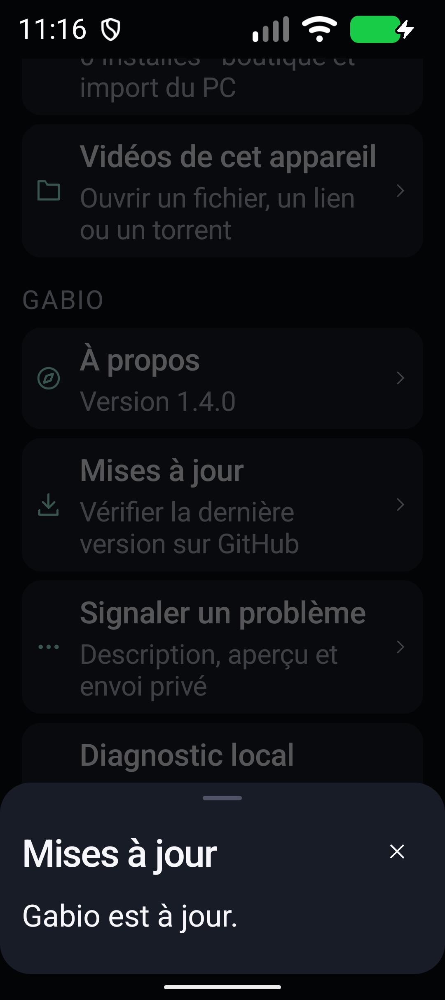
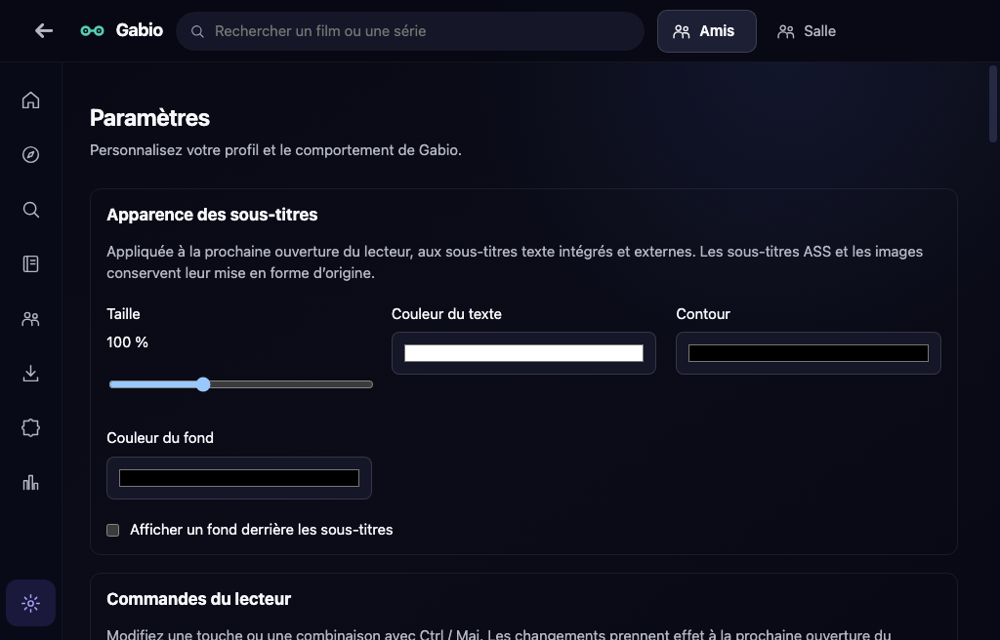

# Gabio — téléchargements et installation

[English installation guide](README.en.md)

Gabio est disponible sur Windows, Android, iPhone, iPad et Mac. Les versions
Apple et Android sont des préversions. Les sources de l’application restent privées.

## Sommaire

- [Dernier IPA et tous les téléchargements](#dernière-version-iphone--ipad)
- [Choisir Français ou English](#choisir-français-ou-english)
- [Installer et mettre à jour sur Windows](#installer-sur-windows)
- [Installer et mettre à jour sur Android](#installer-sur-android)
- [Premier lancement Android : nom, addons et synchronisation](#premier-lancement-sur-android)
- [Installer et mettre à jour sur iPhone/iPad avec AltStore](#installer-sur-iphone-ou-ipad)
- [Installer et mettre à jour sur Mac](#installer-sur-mac)
- [Alertes de sécurité et dépannage](#alertes-de-sécurité-et-dépannage)
- [Vérification et limites de la bêta Apple](#vérification-et-limites-de-la-bêta-apple)

## Dernière version iPhone / iPad

**Gabio 0.1.0 — build 3** :
[télécharger le dernier IPA universel Gabio-iOS-0.1.0-unsigned.ipa](https://github.com/GabGaabS/gabio-release/releases/download/apple-v0.1.0/Gabio-iOS-0.1.0-unsigned.ipa).
Un seul IPA convient à l’iPhone et à l’iPad, à partir d’iOS/iPadOS 17.0.

[Ajouter Gabio dans AltStore Classic](https://altstore.io/source/raw.githubusercontent.com/GabGaabS/gabio-release/main/altstore/gabio.json?app=io.gabio.apple) ·
[Voir les notes de la bêta Apple](https://github.com/GabGaabS/gabio-release/releases/tag/apple-v0.1.0) ·
[Empreintes SHA-256](https://github.com/GabGaabS/gabio-release/releases/download/apple-v0.1.0/SHA256SUMS-Apple.txt)

| Plateforme | Téléchargement | Installation |
| --- | --- | --- |
| Windows | [Dernière version stable](https://github.com/GabGaabS/gabio-release/releases/latest) : fichier `Gabio-Setup-…exe` | Ouvrir l’installateur ; conserver l’installation existante pour une mise à jour. Installateur actuellement non signé. |
| Android | **2.1.0 (code 32)** : [APK ARM64](https://github.com/GabGaabS/gabio-release/releases/download/android-v2.1.0/Gabio-Android-2.1.0-arm64-v8a.apk) · [APK universal](https://github.com/GabGaabS/gabio-release/releases/download/android-v2.1.0/Gabio-Android-2.1.0-universal.apk) | Autoriser l’installation depuis le navigateur utilisé, puis installer par-dessus Gabio. Certificat historique conservé. |
| iPhone / iPad | [IPA 0.1.0, build 3](https://github.com/GabGaabS/gabio-release/releases/download/apple-v0.1.0/Gabio-iOS-0.1.0-unsigned.ipa) | [Guide AltStore](#installer-sur-iphone-ou-ipad) ; signature personnelle nécessaire. |
| Mac Apple Silicon | [ZIP 1.1.0 ARM64](https://github.com/GabGaabS/gabio-release/releases/download/macos-v1.1.0/Gabio-macOS-1.1.0-arm64.zip) | [Guide Mac](#installer-sur-mac), macOS 13 minimum. |
| Mac Intel | [ZIP 1.1.0 Intel/x64](https://github.com/GabGaabS/gabio-release/releases/download/macos-v1.1.0/Gabio-macOS-1.1.0-x64.zip) | [Guide Mac](#installer-sur-mac), macOS 13 minimum. |

## Choisir Français ou English

**Windows 4.1.0** propose les deux langues : ouvrez **Paramètres → Langue de
l’interface → Français / English**, puis choisissez votre langue. En anglais,
le chemin est **Settings → Interface language**.

Le choix est enregistré sur cet appareil. Votre bibliothèque, historique,
addons et fichiers conservés restent disponibles ; les langues audio et
sous-titres se règlent séparément. Les titres, résumés et noms de pistes fournis
par les catalogues ne sont pas traduits par ce réglage.

**Android 2.1.0** propose aussi les deux langues : ouvrez **Profil → Langue
de Gabio → Français / English**. En anglais, le chemin est **Profile → Gabio
language**. Le choix reste enregistré après fermeture et mise à jour.

**Mac 1.1.0** propose Français / English : ouvrez **Paramètres → Langue de
l’interface** (**Settings → Interface language** en anglais). Le choix reste
enregistré après fermeture et mise à jour ; pendant la lecture, la vidéo,
la position, les pistes, le volume et la calibration sont conservés.

iPhone/iPad conserve une interface française avec **0.1.0/build3**. Sa prochaine
version majeure bilingue est en cours de contrôle ; le lien IPA ci-dessus
désigne la dernière version publiée.

<details>
<summary>Capture Gabio Windows 4.0 : choisir l’anglais</summary>

Vraie interface Electron du build publié, avec un profil de test sans données
personnelles. La sélection English est enregistrée et conservée au redémarrage.



</details>

<details>
<summary>Capture Gabio Android 2.0 : le profil en anglais</summary>

Vrai APK publié, sur un émulateur isolé avec police à 200 %. Le profil
par défaut ne montre aucun compte ni historique personnel.



</details>

## Installer sur Windows

### Première installation

1. Sur le PC Windows, ouvrez la [dernière version stable](https://github.com/GabGaabS/gabio-release/releases/latest).
2. Dans **Assets / Fichiers**, téléchargez **Gabio-Setup-…exe**. Le fichier `.blockmap` et `latest.yml` servent au système de mise à jour : ils ne sont pas des installateurs.
3. Ouvrez le fichier EXE et suivez l’installation, puis lancez Gabio.

**L’installateur Windows est actuellement non signé**, faute de certificat de
signature de code Windows. Le navigateur ou Windows peut donc afficher
« application non reconnue », « éditeur inconnu » ou « Windows a protégé votre
ordinateur ». Ce sont des alertes possibles de réputation/signature ; elles ne
constituent pas une analyse garantissant la sécurité du fichier.
[Explication Microsoft](https://learn.microsoft.com/fr-fr/windows/apps/package-and-deploy/smartscreen-reputation).

Après avoir vérifié que le fichier vient bien de **GabGaabS/gabio-release** et
comparé son empreinte aux notes de version, si SmartScreen propose l’option,
**Informations complémentaires → Exécuter quand même** permet cette installation.
Sur un PC géré ou protégé par Smart App Control, cette option peut être absente.
N’ouvrez pas un fichier signalé comme malveillant en supposant que tout avertissement
vient de la signature ; gardez le message exact pour le dépannage.

### Mettre à jour sur Windows

Gabio vérifie son canal au démarrage et annonce une nouvelle version. Dans la
fenêtre de mise à jour, choisissez **Télécharger**, puis **Installer et relancer**
quand le téléchargement est terminé. Vous pouvez aussi utiliser **Paramètres →
Mises à jour → Rechercher une mise à jour**, puis **Redémarrer et installer**.

Si la mise à jour intégrée échoue, téléchargez le nouvel EXE depuis le même lien
stable et installez-le par-dessus Gabio. **Ne désinstallez pas Gabio** pour une
simple mise à jour : bibliothèque, historique, réglages et fichiers conservés
doivent être gardés. Le nouvel EXE peut présenter les mêmes alertes de signature.

<details>
<summary>Capture Gabio : les mises à jour sur Windows</summary>

Interface française, capturée avec un profil de test sans données personnelles.



</details>

## Installer sur Android

### Première installation

Android **8 minimum**. Sur le téléphone/tablette, ouvrez la
[préversion Android 2.1.0 (code 32)](https://github.com/GabGaabS/gabio-release/releases/tag/android-v2.1.0).
Téléchargements directs : [APK ARM64](https://github.com/GabGaabS/gabio-release/releases/download/android-v2.1.0/Gabio-Android-2.1.0-arm64-v8a.apk) · [APK universal](https://github.com/GabGaabS/gabio-release/releases/download/android-v2.1.0/Gabio-Android-2.1.0-universal.apk).

1. Téléchargez l’APK **ARM64** pour la plupart des téléphones récents. Si votre appareil n’est pas compatible ou si vous hésitez, prenez l’APK **universal**, plus volumineux. Les APK x86/x64 servent principalement aux émulateurs.
2. Ouvrez le fichier depuis les téléchargements du navigateur ou le gestionnaire de fichiers.
3. Si Android demande une autorisation, ouvrez ses **Paramètres → Autoriser depuis cette source** pour ce navigateur/gestionnaire, puis revenez à l’APK et choisissez **Installer**. Les libellés dépendent du fabricant. Vous pouvez retirer cette autorisation après installation.
4. Ouvrez Gabio depuis l’écran d’accueil.

Android peut avertir de l’installation d’une app inconnue ou proposer une analyse
Play Protect parce que l’APK vient d’Internet, hors Google Play. **L’APK Gabio est
bien signé**, avec le certificat historique utilisé par les installations Gabio
existantes ; il n’est pas distribué ou validé par le Play Store. Une alerte Android
n’est donc pas décrite comme une absence totale de certificat.
[Installation depuis une autre source](https://support.google.com/pixelphone/answer/7391672?hl=fr),
[avertissements Play Protect](https://developers.google.com/android/play-protect/warning-dev-guidance?hl=fr).

Si un système de protection bloque réellement l’installation, conservez le
message et la référence de l’APK. Ne désactivez pas globalement Play Protect ou
les protections de l’appareil pour contourner un diagnostic inconnu.

### Premier lancement sur Android

Avec **Android 2.1.0 (code 32)**, une installation neuve propose une seule fois
les mêmes premières étapes que sur PC :

1. Choisissez le **nom** affiché dans vos séances entre amis, puis **Continuer**.
2. Choisissez vos addons parmi **ThePirateBay+**, **OpenSubtitles v2** et
   **Torrentio** avec les versions CAM exclues. Touchez **Installer les addons
   sélectionnés** pour confirmer leur ajout, ou **Continuer vers mes appareils**
   pour passer cette étape. Les addons déjà configurés, même désactivés, sont conservés.
3. La **synchronisation est facultative**. Pour retrouver votre nom, votre
   bibliothèque et votre progression, touchez **Synchroniser avec mes appareils**.
   Sur le PC déjà configuré, ouvrez **Profil et synchronisation → Afficher le code**,
   puis saisissez ce code privé uniquement dans le formulaire Gabio du téléphone.
   Votre bibliothèque est fusionnée ; les vidéos restent sur chaque appareil.
   Vous pouvez aussi terminer avec **Découvrir Gabio** sans association.

Si le PC n’a pas encore de chaîne, choisissez **Créer une chaîne privée** et
attendez la confirmation de synchronisation avant de partager son code. Sur le
téléphone, une association **en attente** indique que l’échange n’est pas encore
confirmé : utilisez **Synchroniser maintenant** et gardez le message affiché
si la chaîne reste introuvable. Ne transmettez jamais ce code dans un salon public.

**Configurer plus tard** ferme l’assistant. Il ne s’affiche plus automatiquement,
même après interruption, fermeture ou mise à jour. Une installation déjà utilisée
conserve ses données et n’ouvre pas l’assistant lors de cette mise à jour.
Pour le revoir volontairement, ouvrez **Profil → Revoir la configuration initiale**.

<details>
<summary>Capture Android 2.0.2 : proposition facultative de synchronisation</summary>

Vraie interface de l’APK release, en anglais, sur un émulateur isolé avec police
à 200 %. Aucun nom personnel, code d’association ni bibliothèque utilisateur n’est affiché.



</details>

### Mettre à jour sur Android

Dans Gabio, ouvrez **Profil → Mises à jour** et choisissez **Voir la mise à jour**
lorsqu’une nouvelle version est annoncée. Si vous avez choisi l’anglais dans
Android 2.0, les mêmes commandes sont **Profile → Updates → View update**. Téléchargez son APK, ouvrez-le et
confirmez **Mettre à jour / Installer** sur l’application existante. L’installation
reste confirmée par Android ; Gabio n’installe pas silencieusement un APK.

<details>
<summary>Capture Gabio : les mises à jour dans le profil Android</summary>

Interface française sur émulateur, avec un profil de test sans données personnelles.



</details>

Gardez le même canal officiel et ne désinstallez pas Gabio : le certificat
historique permet de conserver vos données pendant la mise à jour. Si Android
annonce un conflit de signature ou « app non installée », vérifiez que l’APK vient
bien de ce dépôt et que son architecture convient ; signalez le message avant
toute suppression de données.

## Installer sur iPhone ou iPad

### Recevoir les mises à jour dans AltStore

Une fois AltStore Classic installé avec les étapes ci-dessous, ouvrez ce README
dans Safari sur l’iPhone/iPad et touchez
**[Ajouter Gabio dans AltStore Classic](https://altstore.io/source/raw.githubusercontent.com/GabGaabS/gabio-release/main/altstore/gabio.json?app=io.gabio.apple)**. Confirmez l’ajout
de la source Gabio, puis ouvrez sa fiche dans **Browse / Parcourir**.

Si le lien ne s’ouvre pas, ouvrez **Sources → +** dans AltStore (depuis
**Browse / Parcourir** ou l’onglet Sources, selon la version) et collez cette
adresse complète :

```text
https://raw.githubusercontent.com/GabGaabS/gabio-release/main/altstore/gabio.json
```

AltStore peut alors télécharger Gabio et proposer les nouvelles versions dans
**My Apps / Mes apps → Update / Mettre à jour**. AltServer doit être accessible
pour signer et installer la mise à jour. **Refresh All renouvelle la signature** ;
ce n’est pas le bouton de téléchargement d’une nouvelle version. La détection
des nouveautés est automatique ; une installation silencieuse sans PC n’est pas promise.
[Fonctionnement officiel des mises à jour](https://faq.altstore.io/developers/updating-apps).

Si Gabio est déjà installé depuis un IPA, conservez le même compte Apple et
installez par-dessus. Ne désinstallez pas l’app pour ajouter la source. Le parcours
d’ajout de cette source reste à confirmer sur appareil ; l’import manuel décrit
ci-dessous reste disponible.

Utilisez **AltStore Classic** avec **AltServer** sur le PC. Un seul fichier
`Gabio-iOS-0.1.0-unsigned.ipa` convient aux deux appareils. Aucun abonnement Apple payant n’est
nécessaire pour ce parcours personnel ; l’IPA téléchargé doit être signé par
AltStore avant de pouvoir s’ouvrir.

### 1. Préparer le PC et l’appareil

Installez [AltServer pour Windows](https://altstore.io/), iTunes et iCloud selon
le [guide Windows officiel](https://faq.altstore.io/altstore-classic/how-to-install-altstore-windows).
Il recommande les versions Apple d’iTunes/iCloud et décrit une solution distincte
pour iCloud du Microsoft Store. Si ces outils sont déjà installés, vérifiez leur
compatibilité avant de les remplacer.

Lancez AltServer. Branchez l’appareil déverrouillé en USB et acceptez sa demande
de confiance sur l’appareil. Pour le renouvellement sans câble, activez ensuite
la synchronisation Wi-Fi de cet appareil dans iTunes.

<details>
<summary>Capture officielle : synchronisation Wi-Fi dans iTunes</summary>


</details>

### 2. Installer AltStore Classic

Dans l’icône AltServer près de l’horloge Windows : **Install AltStore → votre
iPhone/iPad**. Saisissez votre compte Apple directement dans AltServer.

Sur l’appareil, autorisez votre profil personnel dans **Réglages → Général →
VPN et gestion de l’appareil**. Activez **Réglages → Confidentialité et sécurité
→ Mode Développeur**, puis confirmez le redémarrage demandé. Les intitulés
peuvent varier selon iOS/iPadOS. [Procédure AltStore](https://faq.altstore.io/altstore-classic/how-to-install-altstore-windows).

<details>
<summary>Capture officielle : emplacement du mode Développeur</summary>


Crédit : 9to5Mac, via la documentation AltStore.

</details>

### 3. Installer Gabio

Téléchargez [**Gabio-iOS-0.1.0-unsigned.ipa**](https://github.com/GabGaabS/gabio-release/releases/download/apple-v0.1.0/Gabio-iOS-0.1.0-unsigned.ipa),
depuis Safari sur l’appareil. Conservez-le dans Fichiers.

Ouvrez AltStore Classic → **My Apps → +** en haut à gauche, puis choisissez cet
IPA. AltServer doit rester accessible par USB ou sur le même réseau Wi-Fi.
Après la signature et l’installation, ouvrez Gabio. Les archives macOS ne
s’installent pas sur un iPhone/iPad.

Si vous avez téléchargé l’IPA sur le PC : maintenez **Maj (Shift)** en cliquant
l’icône AltServer près de l’horloge, puis choisissez **Sideload .ipa…** et
l’appareil. Sélectionnez l’IPA Gabio ; saisissez vous-même votre compte Apple
dans AltServer si demandé. Ce raccourci est décrit dans les
[notes officielles AltServer](https://faq.altstore.io/release-notes/altserver).

<details>
<summary>Capture officielle : bouton + et renouvellement dans My Apps</summary>


Capture de la [documentation AltStore](https://faq.altstore.io/altstore-classic/your-altstore).
Les apps illustrées sont des exemples officiels ; Gabio apparaîtra dans votre liste.

</details>

### 4. Renouveler et mettre à jour

Avec un compte gratuit, les apps expirent après **sept jours** ; AltStore utilise
aussi l’une des **trois places** d’apps installées. Ouvrez AltServer puis **My Apps
→ Refresh All** avant expiration. Le renouvellement automatique dépend de la
disponibilité du PC et du réseau. [Limites et renouvellement](https://faq.altstore.io/altstore-classic/your-altstore).

Pour une mise à jour Gabio, installez le nouvel IPA avec **le même compte Apple**
sur l’app existante. Gardez son identité et ses données ; ne la désinstallez pas
pour simplement renouveler sa signature. Si AltStore expire, AltServer permet
de le réinstaller par-dessus. [Explication AltServer](https://faq.altstore.io/altstore-classic/altserver).

Si « Could not find AltServer » apparaît, vérifiez le PC allumé, AltServer actif
et la connexion USB/Wi-Fi. [Dépannage officiel](https://faq.altstore.io/altstore-classic/troubleshooting-guide).

Guide vérifié le 9 octobre 2026. Les captures officielles montrent des versions
antérieures de l’interface et servent de repères. L’installation et la mise à
jour de Gabio avec AltStore ont été confirmées sur iPadOS 27.0.1 ; le parcours
iPhone reste à essayer. Aucun identifiant Apple ne doit
être envoyé dans GitHub, Gabio ou le chat.

### Téléchargements en arrière-plan

Sur iOS/iPadOS 26+, Gabio peut demander à iOS de poursuivre les transferts
actifs, avec une progression visible et un arrêt conservant les fichiers.
L’option est en cours de validation. iOS peut la refuser ou l’interrompre ;
gardez Gabio ouvert si elle n’est pas disponible.

AltStore peut changer l’identifiant de l’app lors de la signature. Une
préparation locale de l’IPA peut alors être nécessaire avant l’installation,
avec l’identifiant de **Gabio déjà installé**. Elle ne change ni l’identité
de l’app, ni son code, ni la procédure AltStore ; aucun compte ou mot de passe
n’est demandé. Une adaptation réelle du candidat build3 a été vérifiée : seul
le manifeste des tâches change, les autres fichiers restent identiques.
La mise à jour build3 a été confirmée ; les longs transferts restent à essayer. Ne désinstallez pas
Gabio pour la faire ; cette préparation est facultative pour la lecture et
les téléchargements en gardant l'app ouverte.

## Installer sur Mac

**Gabio Mac 1.1.0 — préversion** : [notes de version](https://github.com/GabGaabS/gabio-release/releases/tag/macos-v1.1.0) ·
[empreintes SHA-256 des deux ZIP](https://github.com/GabGaabS/gabio-release/releases/download/macos-v1.1.0/SHA256SUMS-macOS.txt).
Cette version Mac est distincte de l’IPA ; le dernier IPA reste 0.1.0/build3.

Vérifiez le nom du ZIP et son empreinte SHA-256 avant l’ouverture :

| Fichier | SHA-256 |
| --- | --- |
| `Gabio-macOS-1.1.0-arm64.zip` | `19024878534a3915f5aa89d68634a81d6f9b674cb0f5e90f07f950802963dd62` |
| `Gabio-macOS-1.1.0-x64.zip` | `1be8bc36f4b9f2bc0c5d098f84560c736534abbf0fd3c3a3e8086d19a4e9a626` |


### 1. Choisir le bon téléchargement

Dans **menu Apple  → À propos de ce Mac**, regardez le processeur :

- Une **puce Apple M1, M2, M3, M4…** : [Gabio 1.1.0 Apple Silicon / ARM64](https://github.com/GabGaabS/gabio-release/releases/download/macos-v1.1.0/Gabio-macOS-1.1.0-arm64.zip).
- Un **processeur Intel** : [Gabio 1.1.0 Intel / x64](https://github.com/GabGaabS/gabio-release/releases/download/macos-v1.1.0/Gabio-macOS-1.1.0-x64.zip).

macOS **13 minimum**. Les ZIP Mac contiennent l’application Mac ; l’IPA sert
uniquement aux iPhone et iPad. AltStore et un compte Apple ne sont pas nécessaires
pour installer Gabio sur Mac.

### 2. Installer et ouvrir Gabio

1. Téléchargez le ZIP correspondant depuis le lien ci-dessus.
2. Dans **Finder → Téléchargements**, double-cliquez sur le ZIP pour l’extraire.
3. Déplacez **Gabio.app** dans **Applications**, puis ouvrez-le depuis ce dossier.
4. À la première ouverture, confirmez l’ouverture de l’application téléchargée si macOS le demande.

Gabio possède actuellement une **signature ad hoc**, sans Developer ID ni
notarisation Apple. Si macOS affiche un refus pour développeur non identifié,
après cette première tentative ouvrez **Réglages Système → Confidentialité et
sécurité → Ouvrir quand même**, puis confirmez **Ouvrir**. Cette autorisation
concerne cette application. [Procédure officielle Apple](https://support.apple.com/fr-fr/102445).

<details>
<summary>Capture officielle Apple : autoriser la première ouverture</summary>


</details>

Si le message indique une archive/app endommagée, téléchargez de nouveau le ZIP
et comparez son empreinte avec [SHA256SUMS-macOS.txt](https://github.com/GabGaabS/gabio-release/releases/download/macos-v1.1.0/SHA256SUMS-macOS.txt). Conservez le
message exact si le problème persiste ; ne modifiez pas les protections globales
de macOS pour installer Gabio.

### 3. Mettre à jour sur Mac

La mise à jour Mac est **manuelle** dans cette bêta. Revenez à ce README,
téléchargez le nouveau ZIP de votre architecture, quittez Gabio, extrayez-le
puis remplacez seulement **Gabio.app** dans Applications. Gardez vos données
Gabio et vos fichiers conservés ; leur suppression n’est pas nécessaire.

Le contrôle de mise à jour intégré consulte encore le canal Apple commun,
qui conserve la référence iOS 0.1.0/build3. Ce canal n’annonce pas séparément
cette préversion Mac 1.1.0 ; utilisez les liens Mac de ce README pour l’obtenir.

### 4. Démarrer

Ouvrez **Addons** dans la barre latérale pour configurer vos sources, puis
choisissez un titre et sa version dans **Découvrir** ou **Recherche**. Les salons
et la télécommande exigent Internet ;
chaque appareil lit sa propre vidéo. Les fichiers conservés peuvent être lus
hors connexion. Autorisez le réseau local si vous souhaitez utiliser une fonction
réseau local proposée par Gabio.

### 5. Utiliser les addons installés sur Mac

Dans **Addons**, ouvrez la configuration du fournisseur si elle est demandée,
puis confirmez l’ajout de son manifeste configuré. Dans **Découvrir → Catalogues
de vos addons**, choisissez son catalogue, complétez les critères obligatoires,
puis cliquez sur **Afficher le catalogue**. **Afficher plus** charge la suite
lorsque le fournisseur propose plusieurs pages.

Mac 1.1.0 prend en compte les catalogues de films, séries et anime compatibles,
leurs filtres et recherches, les fiches et épisodes utilisant les identifiants
propres à l’addon, ainsi que les sources et sous-titres qu’il fournit. Les pistes
intégrées au fichier restent accessibles dans le lecteur. Quand un addon renvoie
un site de lecture externe, Gabio propose d’ouvrir ce site.

Les titres ayant une identité propre à l’addon restent en lecture solo ; leur
progression locale n’est pas partagée par Sync. Certaines sources HLS/DASH qui
exigent des en-têtes sur leurs segments sont refusées explicitement : choisissez
alors une autre source.

Les anciens transports JSON-RPC ne sont pas installables. Un addon indisponible,
mal configuré ou renvoyant un format non pris en charge peut encore échouer :
son ajout ne garantit pas toutes les fonctions de son service. Les erreurs du
fournisseur restent affichées ; tous les addons de la boutique n’ont pas été
validés en lecture réelle. Les services protégés par DRM, les plateformes vidéo
spécifiques et les formats spéciaux ne deviennent pas compatibles par ce seul ajout.

<details>
<summary>Capture Gabio : les paramètres sur Mac</summary>

Gabio 0.1.0, interface française sur le Mac de test de compilation.



</details>

## Alertes de sécurité et dépannage

| Plateforme | Alerte possible et raison | Étape à vérifier |
| --- | --- | --- |
| Windows | Éditeur inconnu / réputation SmartScreen : installateur sans certificat Windows. | Dépôt et empreinte corrects ; autorisation de ce fichier si elle est proposée. |
| Android | Source inconnue / analyse Play Protect : APK installé hors Play Store. Le certificat historique reste présent. | Architecture, version et origine de l’APK ; autorisation du navigateur choisi. |
| iPhone/iPad | Profil personnel non approuvé, Mode Développeur désactivé, AltServer introuvable ou signature expirée. | Profil, Mode Développeur, connexion à AltServer et **Refresh All** avant sept jours. |
| Mac | Développeur non identifié : signature ad hoc, sans Developer ID/notarisation. | ZIP de la bonne architecture, empreinte, puis autorisation locale **Ouvrir quand même**. |

Pour un problème persistant, utilisez **Signaler un problème** dans Gabio ou
ouvrez une demande dans l’onglet **Issues** de ce dépôt avec le système, la
version, le nom du fichier et le message exact. Relisez tout diagnostic avant
de le partager. N’envoyez ni compte/mot de passe Apple, ni code Sync, ni URL
privée d’addon. Les alertes qui indiquent explicitement un malware ou un fichier
modifié demandent un examen distinct d’une simple alerte de réputation.

## Vérification et limites de la bêta Apple

Le guide est disponible en français et en anglais. Windows 4.1.0, Android 2.1.0
et Mac 1.1.0 proposent le choix Français / English. L’IPA actuellement publié
reste iOS 0.1.0/build3 en français ; iOS 1.1.0/build7 est en préparation et en contrôle, pas encore publié.

Pour iOS 0.1.0/build3, l’iPad de test a validé mise à jour, design, films/épisodes
et reprise, sous-titres intégrés, masquage des commandes, gestion de Ma liste,
salle, télécommande et Sync. Ses quinze scénarios passent sur chaque famille
de simulateur. Ces résultats historiques ne qualifient pas le candidat iOS 1.0.1/build6.

Mac 1.1.0 passe les contrôles natifs sur deux hôtes macOS 15.7.9, Apple Silicon
et Intel : lecture, menus, hors connexion, plein écran, réduction/restauration,
PiP et retour au lecteur depuis une autre application. La position et les pistes
sont conservées pendant ces parcours, avec un profil de test et des vidéos
synthétiques. Ces essais ne valident pas macOS 13 ni un Mac utilisateur.
L’ouverture du ZIP téléchargé via Gatekeeper sur un Mac utilisateur reste à
confirmer ; les téléviseurs, codecs HDR/audio multicanal et transferts prolongés
conservent leurs limites de validation matérielle.

Les limites sont détaillées dans les [notes Mac 1.1.0](https://github.com/GabGaabS/gabio-release/releases/tag/macos-v1.1.0) et les
[notes iOS 0.1.0](https://github.com/GabGaabS/gabio-release/releases/tag/apple-v0.1.0). Les bibliothèques natives
et leurs licences accompagnent les applications.

Téléchargez depuis ce dépôt public et comparez les
[empreintes SHA-256 Mac 1.1.0](https://github.com/GabGaabS/gabio-release/releases/download/macos-v1.1.0/SHA256SUMS-macOS.txt) ou les
[empreintes SHA-256 iOS 0.1.0](https://github.com/GabGaabS/gabio-release/releases/download/apple-v0.1.0/SHA256SUMS-Apple.txt).
Les canaux Windows et Android, le canal Apple commun et la source AltStore
sont conservés lors de cette publication Mac séparée. Ce dépôt public
distribue les binaires, guides et métadonnées de téléchargement ; il ne reçoit
ni les sources applicatives, ni les données ou diagnostics utilisateur.
